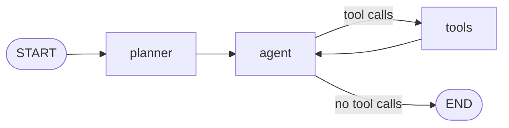

# Fleet Copilot

Fleet Copilot is an agent for an IT team that manages laptops and desktops. It answers fleet health and compliance questions from 30 days of device telemetry, surfaces risks and trends, and can propose operational actions (a remediation ticket, a hardware upgrade order, a replacement flag, an employee notice). It never executes an action on its own: every action waits for an explicit human approval, and every tool call is written to an audit log.

The agent is built with LangGraph on top of Claude. The questions in the eval suite and the CLI prompts are in Spanish; the agent replies in the language the user writes in.

## Installation and setup

Requirements: [uv](https://docs.astral.sh/uv/) and an Anthropic API key. uv installs Python 3.12 if needed.

```bash
make install            # uv sync, installs the locked dependencies from uv.lock
cp .env.example .env    # then set ANTHROPIC_API_KEY in .env
make test               # no API key needed; uses a scripted model
```

The `.env` file needs two values:

| Variable | Meaning |
|---|---|
| `ANTHROPIC_API_KEY` | Your API key. Use a key scoped to a workspace: an unscoped key is rejected with "must include the anthropic-workspace-id header". |
| `FLEET_MODEL` | Model id. Defaults to `claude-sonnet-5-5` when unset. |

The telemetry dataset is vendored in the repository at `data/device-telemetry-dataset.ndjson`: 750 snapshots, 25 devices, 3 companies (`acme-001`, `globex-002`, `initech-003`) and 30 days of history. Nothing is downloaded at run time, so the evals never depend on an external link. Each snapshot has the id `<device_id>@<collected_at>`.

## Running the agent

```bash
make run COMPANY=acme-001
# same thing without make:
uv run fleet-copilot --company acme-001
# one question, then exit:
uv run fleet-copilot --company acme-001 -q "¿Qué equipos se están quedando sin espacio en disco?"
```

The company is fixed for the whole session. There is no command to switch companies inside a conversation: in a production system the company would come from the user's login. For each turn the CLI prints the plan, then each tool call and its result. When the agent proposes an action, the CLI asks "¿Aprobar? [s/N]". Only an explicit "s" approves; anything else rejects.

Two files record what happened:

- `audit.jsonl` gets one line per tool call, including refused and denied ones.
- `outbox/<action>.jsonl` gets one line per approved action, for example `outbox/open_remediation_ticket.jsonl`.

## Running evaluations

```bash
make eval                                             # full suite, live model
make eval ARGS="--repeat 3"                           # same, with make
uv run python evals/run_evals.py --check              # validate evals/cases.yaml, no model calls
uv run python evals/run_evals.py --case acme-low-disk # run one case
uv run python evals/run_evals.py --repeat 3           # run every case 3 times and report pass rates
uv run python evals/run_evals.py --model claude-sonnet-5-5  # override FLEET_MODEL for this run
```

| Flag | Effect |
|---|---|
| `--check` | Validates `evals/cases.yaml` only. No model calls. |
| `--case CASE` | Runs only the case with this id. |
| `--repeat REPEAT` | Runs every case N times and reports pass rates. |
| `--model MODEL` | Model id; overrides `FLEET_MODEL`. |

Each run writes its own outbox and audit log under `evals/runs/<UTC timestamp>/`, so eval runs never touch your real `outbox/`. The full report, with the plan, tool calls, tool results and check results for every run, is written to `evals/report.json`. A setup error (bad key, bad request) stops the run with exit code 2.

### What the suite covers

There are 19 cases in `evals/cases.yaml`, written as Spanish questions an IT admin would ask. Ground truth comes from the unit tests in `tests/test_insights.py` and `tests/test_tools_read.py`. Grading is deterministic, with no LLM judge. A case can check:

- expected and forbidden device ids in the answer;
- forbidden text and required phrases (accents ignored);
- the tools that must be called;
- that every cited snapshot_id exists, belongs to the session company, and that at least one is cited when required;
- expected and forbidden action calls and their statuses (`created`, `rejected`, `refused`);
- that no action was called unless the case expects one (`no_unrequested_action`).

Action cases declare an approval policy (`approve` or `reject`), which the harness answers automatically. Tenant-isolation cases ask about devices or fleets of another company and expect the same "not available" answer as for unknown ids.

### Results

<!-- RESULTS:START -->
Results pending: run `uv run python evals/run_evals.py --repeat 3`.
<!-- RESULTS:END -->

## Agent architecture

The agent is a hand-built LangGraph `StateGraph`. There is no prebuilt agent: the graph owns the order of planning, tool calls and approval, which is what the audit and approval guarantees rely on.



Nodes (`src/fleet_copilot/agent.py`):

- planner: calls the same model with no tools bound and writes a numbered plan of at most 5 steps. The plan is stored in graph state, not in the message history. The planner sees only the text of earlier turns, because the API rejects tool blocks when no tools are declared.
- agent: calls the model with the tools bound. The system prompt is company-aware and the plan is appended to it, so the model follows the plan but may adapt it when a tool result changes what is needed.
- tools: a LangGraph `ToolNode` with the 12 tools described below. Routing uses `tools_condition`.

State has three fields: `messages` (with the `add_messages` reducer), `company_id` and `plan`. Conversations are kept by an in-memory checkpointer (`InMemorySaver`), with thread id `<company_id>:<session>`, so two companies can never share a thread. The recursion limit is 30 steps per turn.

The model never receives raw telemetry. It only sees tool results, and the tools compute every answer with pandas from the dataset.

## Tool catalog

Arguments listed are the ones the model sets. `company_id` is injected from graph state and is absent from every tool schema. Action tools also receive `tool_call_id` injected by LangGraph.

### Read tools (`src/fleet_copilot/tools.py`, `tools_read.py`)

| Tool | Arguments | What it does |
|---|---|---|
| `fleet_insights` | `insight` (optional: `low_storage`, `ram_pressure`, `battery_end_of_life`, `compliance_drift`) | Runs the deterministic detectors over the 30-day history. Omit `insight` to run all four. Preferred for trends and "what needs attention". |
| `list_devices` | `form_factor` (`laptop`, `desktop`), `os_name` (`macOS`, `Windows`), both optional | One row per device from its latest snapshot. |
| `get_device` | `device_id` | Full latest snapshot of one device: hardware, OS, disk, memory, battery, software names, compliance checks. |
| `low_disk_devices` | `threshold_pct` (default 10.0) | Devices whose latest snapshot has less than the threshold percent of disk free. |
| `compliance_failures` | `severity` (`low`, `medium`, `high`), `check_id` (`disk_encryption`, `screen_lock`, `os_up_to_date`), `form_factor`, all optional | Failing checks on each device's latest snapshot. |
| `os_older_than` | `version` (default "15") | macOS devices whose latest OS version is lower than `version`. Windows devices are excluded and named in the notes. |
| `device_timeseries` | `device_id`, `metric` (`disk_free_pct`, `mem_used_pct`, `battery_cycle_count`, `battery_full_charge_capacity`, `battery_condition`, `compliance`) | One value per snapshot, oldest first. For `compliance` the value is the list of failing check ids. |
| `installed_software` | `name` (optional, case-insensitive substring) | Installed software on each device's latest snapshot. |

Every successful read result has the same shape: `{"rows", "evidence", "notes"}`. `evidence` lists the snapshot ids that were checked, including when the answer is "none". `notes` states thresholds, exclusions and data gaps. A device outside the session company, or an unknown id, returns `{"error": ...}` with the same message in both cases.

### Action tools (`src/fleet_copilot/tools_write.py`)

Every action tool takes `evidence`, a list of snapshot ids the model cites from earlier tool results. It returns `status: "created"` after approval, `status: "rejected"` if the human says no, or `status: "refused"` with a reason if the checks fail before anyone is asked. A device of another company, or an unknown device, returns the same `{"error": ...}` as the read tools.

| Tool | Arguments | Precondition checked in code | What happens on approval |
|---|---|---|---|
| `open_remediation_ticket` | `device_id`, `check_id` (`disk_encryption`, `screen_lock`, `os_up_to_date`), `note`, `evidence` | `check_id` must be failing on the device's latest snapshot | Appends a ticket to `outbox/open_remediation_ticket.jsonl` |
| `create_upgrade_order` | `device_id`, `component` (`ram`, `disk`, `battery`), `spec`, `evidence` | The device needs the matching finding: ram needs `ram_pressure`, disk needs `low_storage`, battery needs `battery_end_of_life` | Appends to `outbox/create_upgrade_order.jsonl` |
| `flag_device_for_replacement` | `device_id`, `reason`, `evidence` | At least one hardware finding (`low_storage`, `ram_pressure`, `battery_end_of_life`). A compliance finding alone is not enough. | Appends to `outbox/flag_device_for_replacement.jsonl` |
| `notify_employee` | `employee_id`, `message`, `evidence` | The employee must have at least one device in this company, and the evidence must come from one of that employee's devices | Appends to `outbox/notify_employee.jsonl`. Nothing is sent: the message is only recorded. |

## Insight detectors

Insights come from four fixed rules in `src/fleet_copilot/insights.py`. No model is involved in detection. The model only narrates the rows it receives.

| Insight | Rule | Thresholds (constants) |
|---|---|---|
| `low_storage` | Latest free disk is below the threshold. Category `persistent` if below in at least 80% of snapshots, otherwise `declining`. The slope is a least-squares fit of free percent against days. | `LOW_DISK_PCT = 10.0`, `PERSISTENT_SHARE = 0.8` |
| `ram_pressure` | Memory use above the threshold in at least 80% of snapshots is `consistent`; in at least 25% is `intermittent`. | `RAM_HIGH_PCT = 85.0`, `RAM_INTERMITTENT_SHARE = 0.25` |
| `battery_end_of_life` | Latest battery condition is not Normal, or latest cycle count is at least the limit, or full charge capacity fell since the first snapshot with a battery. | `BATTERY_CYCLES_LIMIT = 1000` |
| `compliance_drift` | `drift`: passed in the first snapshot and fails in the latest. `persistent_failure`: fails in every snapshot. | none |

Each row has a category, a finding with the numbers, an explanation, the metrics and the evidence snapshot ids. Devices without a battery are reported as not applicable. Snapshots with missing battery data are reported as a data gap in the notes, never as a healthy battery.

## Grounding strategy

The answer is only as good as the data behind it, so the design keeps the model away from raw data and makes every claim checkable:

- Typed tools compute the answers. The model picks a tool and its arguments; the numbers come from pandas, not from the model's reading of a dataset dump.
- Every row carries `snapshot_id`, and evidence lists every snapshot the tool checked. A "none" answer is therefore grounded too: the reader can see which devices were looked at.
- Notes carry the thresholds, the exclusions (Windows devices are excluded from the macOS version check) and the data gaps. The system prompt tells the model to repeat any caveat that changes the answer, such as missing battery data.
- The system prompt requires citing snapshot ids in square brackets after each claim, and tells the model to answer only from tool results.
- The evals check that every cited snapshot exists and belongs to the session company, so a fabricated or foreign citation fails a case.

## Guardrails

| Guardrail | How it is enforced |
|---|---|
| Tenant isolation | `company_id` is injected from graph state with `InjectedState`. The model cannot choose or change it, and it is not in any tool schema. Every device and employee lookup is filtered by it. |
| No cross-company leakage | A device of another company gets the same "not available" message as an unknown id. The audit log tells them apart: `cross_tenant_denied` versus `not_found`. The thread id also includes the company. |
| Evidence required | Action tools check that each snapshot id exists, belongs to this company, and belongs to the target device or employee. Missing or foreign evidence is refused before any human is asked. |
| Data preconditions | Each action has a precondition computed from the data (see the action table). The model's claims about the device are not trusted. |
| Human approval | Each valid proposal pauses the graph with `interrupt()` and waits for a yes or no. Nothing is written before approval. |
| Idempotency | Actions are keyed by the tool call id. LangGraph re-runs a tool from the top on resume, and also re-runs already-decided actions when several approvals are pending; a call that already has a final outcome in the audit log returns that outcome without writing again. |
| Audit log | Every tool call is recorded in `audit.jsonl` with its outcome: `ok`, `invalid_args`, `cross_tenant_denied`, `not_found`, `refused_insufficient_evidence`, `rejected`, `approved` or `write_failed`. |
| Action only on request | The system prompt allows an action tool only when the user asks for one or agrees to one the agent suggested. The `no_unrequested_action` eval check enforces this. |
| No false success | The system prompt forbids saying an action was done unless the tool returned `created`. A refused proposal is never retried with made-up evidence. |

## Key design decisions and trade-offs

- Deterministic detectors instead of model inference. Thresholds are written down, so a finding can be reproduced and tested. The cost is that the rules are only as good as their thresholds, and they cannot notice patterns nobody wrote a rule for.
- A hand-built `StateGraph` instead of a prebuilt agent. The graph has to guarantee the order of planning, tool calls and approval, and the audit trail depends on it. A prebuilt loop would make that harder to control and test. The cost is more code to maintain.
- A separate planner call with no tools. The plan is visible in the CLI and in `evals/report.json`, and it steers the agent. The cost is one more model call per question, so more latency and tokens.
- Isolation in code, not in the prompt. A prompt can be talked around; an injected argument cannot be overridden by the model.
- Identical "not available" messages for another company's device and an unknown device. This avoids revealing whether a device exists elsewhere. The cost is that the user cannot be told which of the two happened; the audit log holds that difference for operators.
- Evidence checked in code. The model proposes evidence; the tool verifies it. The cost is that a correct action can be refused when the evidence is cited loosely, so the refusal message says what is missing.
- Outbox files instead of real integrations. Approved actions are written as JSON lines, so the behaviour can be inspected and tested without a ticketing system. Wiring a real system means replacing the append step in `tools_write.py`.
- In-memory checkpointer (`InMemorySaver`). It is simple and keeps tests isolated, but conversations are lost on restart. Passing a SQLite or Postgres checkpointer to `build_graph` replaces it.
- Substring-based eval grading. It is cheap and reproducible, and it does not need a judge model. The cost is that a correct answer worded differently can fail, so cases list several acceptable phrasings where it matters.
- Determinism. The chosen model does not allow pinning temperature, so the agent is not bit-for-bit reproducible. The tools are deterministic, and the eval suite measures pass rates with `--repeat` instead of assuming a single run is representative.

## Known limitations

- Conversation memory lives in RAM. Restarting the process ends every session.
- `notify_employee` only records the message in the outbox. Nothing is sent to the employee.
- Refusal and "not found" answers are detected in the evals by substring matching, so an answer phrased outside the listed phrases can fail a case.
- A 400 error on one eval case stops the whole run instead of being recorded as a failure for that case.
- `data.py` assumes one volume per device when it reads disk metrics.
- The dataset is a 30-day sample of 25 devices. The thresholds are fixed constants and would need review for a real fleet.

## Project layout

```text
rayda-fleet-copilot/
  Makefile                       install, test, eval, run targets
  pyproject.toml                 dependencies; the fleet-copilot script
  .env.example                   ANTHROPIC_API_KEY and FLEET_MODEL
  data/
    device-telemetry-dataset.ndjson   vendored telemetry, 750 snapshots
  src/fleet_copilot/
    agent.py                     LangGraph graph, prompts, planner, state
    tools.py                     read tool wrappers and fleet_insights
    tools_read.py                read-only lookups over the dataset
    tools_write.py               action tools, approval, outbox
    insights.py                  deterministic detectors and thresholds
    data.py                      loads and indexes the dataset
    audit.py                     audit.jsonl writer and outcome lookup
    cli.py                       fleet-copilot command: chat and -q mode
  tests/                         pytest suite, scripted model, no API key
  evals/
    cases.yaml                   19 eval cases and their field reference
    run_evals.py                 eval runner and report writer
    runs/                        per-run outbox and audit (generated)
    report.json                  latest eval report (generated)
  outbox/                        approved actions, one JSON line each (generated)
  audit.jsonl                    audit log of tool calls (generated)
```
